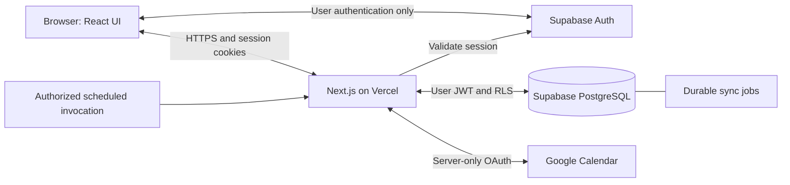

# Ventus — Technical Architecture

**Status:** Authentication and five-table database foundation implemented; persistent Dashboard integration and later architecture remain unfinished/proposed.

**Reviewed:** October 19, 2026.

## 1. Scope and existing foundation

`PRD.md` governs behavior; `AGENTS.md` governs development; `SECURITY.md` governs release. Recommendations here do not approve unresolved behavior or external services.

The working Next.js foundation has npm checks and GitHub history. Milestone 1 task workflows use in-memory fixtures. Milestone 2 includes email/password auth pages/actions, SSR callbacks, logout, and server-protected Dashboard access. At finalization on October 19, 2026, the project owner reported registration, login, logout, and protected Dashboard access passed manual verification. Password recovery is pending manual verification due to Supabase rate limiting; it is not passed. All 16 automated authentication tests, lint, typecheck, and build pass. Persistence and remaining release checks are pending. Product Phase 2 remains deferred. The approved five-table database foundation is applied to hosted development; 132 local assertions and hosted structural verification passed. Hosted user-level behavior and application persistence remain untested/unimplemented respectively. See `PROJECT_STATUS.md` and `supabase/tests/HOSTED_RESULTS.md`.

## 2. Technology assessment

| Choice | State | Responsibility, fit, and implications |
|---|---|---|
| Next.js 16.4.2, React 19.3.1, TypeScript | Existing | Shared frontend/backend deployment. Follow installed guides, including `proxy.ts` conventions. |
| Tailwind CSS 4 | Existing | Consistent responsive styling without another styling system. |
| shadcn/ui | Proposed | Accessible modal/menu primitives when needed; copied code requires maintenance. Native controls suffice initially. |
| Supabase PostgreSQL and Auth | Auth and database foundation implemented | Official clients and approved project-local Supabase CLI installed. Both five-table migrations applied to hosted development. Persistent application integration, backups/recovery and release verification remain pending. |
| rrule.js (`rrule`) | Proposed; requires approval | Recurrence adapter avoids custom algorithms; validate timezone semantics and maintenance/security. [Guidance](https://github.com/jkbrzt/rrule). |
| Google Calendar API | Product integration approved; technical setup pending | Synchronize linked events. OAuth consent verification, quotas, and refresh failures introduce operational work. |
| Existing checks; Node test runner; Playwright | Checks existing; testing proposed | Built-in runner for pure rules after TypeScript compatibility validation; Playwright for workflows. Consider another unit runner only for simpler configuration. |
| Vercel | Proposed preferred host | Native Next.js previews and deployment. Paid scheduling may be necessary; eligibility and budget remain open. |
| GitHub | Existing | Source/history at `dbellis4-cmd/ventus`; commits, pushes, and deployment integration require explicit instruction. |

Postgres can hold durable synchronization jobs; no separate broker or ORM is needed initially.

## 3. System boundaries

Server Components load authorized data; Client Components handle interaction. Server Actions mutate tasks; Route Handlers serve callbacks and workers. Both call shared domain services and server-only data-access functions.

The diagram includes planned persistence/Calendar paths; the current Dashboard still uses fixtures.



**PostgreSQL is the canonical task/history store.** Google events are linked representations; incoming edits pass through normal validation and lifecycle rules.

Normal queries carry user JWTs with RLS. Privileged workers enforce ownership separately. Return minimal view models without credentials, following `node_modules/next/dist/docs/01-app/02-guides/data-security.md`.

## 4. Applied database foundation

Exactly five core tables are applied in development:

| Table | Purpose and relationships |
|---|---|
| `user_settings` | One row per managed Auth user; selected IANA zone, appearance and initialization marker. Auth-user deletion cascades to settings. |
| `categories` | User-owned default/custom categories with behavior, Calendar preference, archive marker and version. |
| `tasks` | User-owned definitions, category and immutable parent references, creation key/fingerprint, versions and soft-deletion marker. |
| `task_occurrences` | One stable `once` identity per nonrecurring task; original/current dates, times, zones and instants, parent occurrence, category snapshot, lifecycle status and actual/recorded completion times. |
| `task_activity` | Append-only owned before/after history, effective and recorded timestamps, occurrence/version uniqueness. |

Owner-matching composite foreign keys reject foreign-user references. Root ownership cascades support authorized permanent account erasure; deferred cross-references allow whole-account removal while preventing dangling references at commit. Individual task deletion remains soft deletion. No account-deletion endpoint/interface exists.

All five tables have ENABLE/FORCE RLS. Authenticated users have owner-filtered SELECT, no direct DML, and EXECUTE only on ten narrow public RPCs. These SECURITY DEFINER RPCs have empty search paths, `row_security=on`, and a restricted NOLOGIN/NOINHERIT/NOBYPASSRLS writer owner separate from table ownership. Private helpers are unavailable to API roles. The sole postgres-owned private definer trigger permits history erasure only after the Auth owner is absent; history UPDATE is always rejected.

Atomic RPCs cover initialization, settings/categories, task/subtask creation and editing, completion/correction/reopening, postponement, cancellation and subtree soft deletion. Hierarchy-root/target locks and expected-version checks prevent lost edits; independent roots remain concurrent. Creation keys with payload fingerprints and occurrence/history uniqueness prevent duplicate effects without a command-receipt framework. Application callers must preserve these contracts and verify the user's session/origin before writes; no elevated key is used for normal requests.

Approved default names are Classes, Meetings, Assignments, Professional Events, Social Events, Personal Tasks and Miscellaneous. Lazy `initialize_workspace(timezone)` creates owned settings/defaults once and never resets renamed/archived defaults. Historical snapshots survive category changes. Initial behavior mappings and operational bounds remain reviewable, as documented in `supabase/SCHEMA.md` and `supabase/OPERATIONS.md`.

Both migrations (`20261019000100`, `20261019000200`) succeeded on project `dxplprepnfuvfpqmmslf`, branch `main`, PostgreSQL 17.11, and are recorded in migration history. Source hashes match the files that passed **132 local assertions**. Hosted read-only catalogs verified tables, RLS/policies, permissions, functions, constraints, indexes, triggers and history; **hosted user-level behavior has not been tested**. Do not reapply/reset these applied files or rewrite their contents. See `supabase/tests/RESULTS.md` for local scope and `supabase/tests/HOSTED_RESULTS.md` for hosted evidence.

Separate schedule-revision tables, complex retry-response replay and reward infrastructure are deferred. Recurrence inputs are explicitly rejected until Milestone 4; no `task_schedules` table exists. Calendar connection/link/job tables are future proposals, to be added only when authorized integration work needs them.

## 5. Authentication and security

**Approved for Milestone 2:** standard Supabase SSR cookie sessions and the official client packages. Browser authentication uses a publishable key and user-session credentials. Registration/login/recovery actions and email callbacks are implemented. Dashboard access, password updates, and the session endpoint verify users with `getUser()`; the proxy refreshes sessions with `getClaims()`. Logout uses local scope and clears navigation state. Mocked tests and anonymous production HTTP checks pass. The owner reports registration, login, logout, and protected Dashboard access manually passed. Password recovery is pending manual verification due to Supabase rate limiting, despite passing mocked regression tests. Preserve those fixes and the session configuration. The existing email-verification policy is respected; confirm it and signup abuse controls before public release. Database requests will carry user JWTs when persistence is introduced.

Browser-readable user access/refresh tokens remain sensitive bearer credentials. Application secret/service-role keys bypass RLS; these and Google tokens must remain server-only.

Use `Secure`, appropriate `SameSite` (normally `Lax`), narrow cookie scope, and supported refresh handling in `proxy.ts`. Browser-managed session cookies are not `HttpOnly`. Authorize every operation, protect against CSRF, validate origins, and prevent cross-user caching. Test expiry/logout/revocation: local JWT validation alone cannot prove session revocation. [SSR guidance](https://supabase.com/docs/guides/auth/server-side/advanced-guide), [Next.js integration](https://supabase.com/docs/guides/auth/server-side/creating-a-client?queryGroups=framework&framework=nextjs).

A server-only `HttpOnly` alternative reduces JavaScript token exposure but requires different auth/refresh handling and server-mediated access. Prefer standard SSR for maintainability unless stricter isolation is required.

`AGENTS.md` now permits browser-side Supabase user-session tokens through this approved flow, while keeping privileged application credentials and Google OAuth tokens server-only. RLS, XSS, CSRF, and session protections remain required.

Enable ownership RLS from the first migration. Test anonymous/two-user database access. Deny user access to provider credentials and protected writes; review functions/views for bypass. [RLS guidance](https://supabase.com/docs/guides/database/postgres/row-level-security).

Validate server inputs/references, parameterize queries, escape content, and apply `SECURITY.md`. Rate limiting and bot protection precede public signup.

## 6. Lifecycle, recurrence, and time

Create task definitions, occurrence slots and activity atomically through the applied RPCs. Edits preserve original scheduling; completion stores actual and recorded times. Corrections append history. Subtask completion never automatically completes the parent.

Expand requested windows plus bounded lookahead. Resume elapsed-interval catch-up from a watermark so missed occurrences are not lost. Upsert immutable slots and retain historical occurrences; never expand infinite rules without bounds.

Approved behavior maps to these projections:

- Fixed commitments stay on their scheduled historical dates.
- Consequential unfinished deadlines appear overdue while retaining original deadlines.
- Flexible unfinished occurrences project onto the eligible day without daily duplication; history uses stored schedules/activity. Collision with the next recurrence requires approval.
- Postponement records schedule changes; cancellation is distinct. Use the approved soft-deletion/history model; retention periods and backup-erasure policy remain open.

Use approved date-only anytime slots, explicit selected IANA zones and UTC instants for timed tasks. Preserve original slots; account-zone changes never move existing schedules. Reject DST gaps; ambiguous times require an explicit offset/instant choice. These cases passed local database tests; UI integration is pending. Recurrence wall-clock behavior, month-end/leap-day expansion, collisions and overdue cutoffs remain Milestone 4 decisions. No recurrence expansion or midnight worker is implemented.

## 7. Google Calendar synchronization

Use per-user authorization-code consent, validated state, exact redirects, and supported PKCE. Background sync needs offline access. Encrypt tokens using established authenticated encryption/versioned server keys; serialize refresh and exclude secrets from user-readable data/logs. [Google OAuth](https://developers.google.com/identity/protocols/oauth2/web-server).

Propose one owned calendar initially and the narrowest event-write scope compatible with it (`calendar.events.owned` candidate); broader/shared-calendar support requires review. [Scope reference](https://developers.google.com/workspace/calendar/api/auth).

Commit outbound intent first. Bounded workers use leases, retry classification, and capped backoff/jitter. Google-compatible deterministic IDs deduplicate creation; conditional ETag writes prevent blind overwrites. [Event creation](https://developers.google.com/workspace/calendar/api/v3/reference/events/insert).

Poll per-calendar incremental cursors in resumable pages; advance cursors after durable processing. HTTP 410 triggers remote-snapshot rebuilding, preserving Ventus history. Only known links affect tasks. [Incremental synchronization](https://developers.google.com/workspace/calendar/api/guides/sync).

Compare shared-field snapshots and versions to suppress echoes; record mutation source. When both sides changed, propose pausing the link for resolution. Conflict UI and external-deletion behavior require approval.

Propose one event per materialized occurrence. Native recurring masters reduce volume but complicate exceptions. Approve representation/export horizon; preserve links on rescheduling. Surface Google series conversions and unsupported edits for resolution. [Recurring-event semantics](https://developers.google.com/workspace/calendar/api/guides/recurringevents).

Propose title/location/schedule mapping, with anytime tasks as all-day dates and exclusive ends. Timed-event duration is absent from the PRD. Approve duration, cancellation/deletion, sync-unchecking, and recurrence-edit mappings. Event edits never automatically complete tasks.

Disconnect immediately blocks jobs, revokes grants, and removes tokens after safe failure handling. Propose preserving Google events; approve reconnect reconciliation.

## 8. Application structure

Create paths only as needed:

```text
app/                         pages, layouts, colocated Server Actions
  (auth)/                    signup/login/recovery pages
  (app)/dashboard/, settings/ protected application pages
  auth/callback/             Supabase callback
  api/google/                OAuth callbacks and sync endpoints
  api/jobs/                  authenticated bounded worker invocation
components/                  shared UI and task/dashboard components
lib/tasks/                   pure lifecycle, recurrence, time rules
lib/server/                  auth, data access, task services, Google adapters
lib/validation/              boundary schemas/validation functions
tests/                       unit, database integration, Playwright workflows
supabase/migrations/          applied versioned schema/RLS and nonrecurring RPCs
proxy.ts                     session refresh if required
```

Keep server modules explicitly server-only. No generic repository framework or duplicated REST layer for internal component reads.

## 9. Testing, hosting, and operations

Develop with `npm run dev`; run lint, typecheck, build, and relevant tests. Unit-test lifecycle, recurrence, date boundaries, and idempotency. Integration-test transactions/RLS with anonymous and two-user credentials. Browser-test registration, dashboard editing, logout, and Calendar failure recovery; use dedicated test calendars.

Commit/push only when instructed. Once deployment is authorized, use reviewed GitHub changes for previews with isolated nonproduction data, OAuth clients/redirects, and secrets. Production requires the `SECURITY.md` gate, owner approval, and rollback readiness. Separate public configuration from server credentials; never prefix secrets with `NEXT_PUBLIC_`.

Vercel Hobby permits personal noncommercial use and has usage limits. Each Hobby cron runs at most daily with imprecise timing; frequent reliable background sync needs approved paid scheduling or another scheduler. Functions are bounded invocations, not permanent workers. Start with action-triggered delivery, sync on dashboard entry/manual refresh, and a daily recovery sweep; this prototype does **not** guarantee prompt sync while users are absent. Agree freshness before release. [Hobby eligibility](https://vercel.com/docs/plans/hobby), [Cron limits](https://vercel.com/docs/cron-jobs/usage-and-pricing).

Polling avoids initial webhook lifecycle overhead. Google push notifications can later wake incremental sync, but require expiring-channel renewal and recovery polling. [Push guidance](https://developers.google.com/workspace/calendar/api/guides/push). A conventional Node host with a worker is an alternative only if continuous processing justifies server operations.

Record redacted failures, retry backlog, stale connections, and alerts. Select backup retention/recovery targets and rehearse restores before real-data release; do not assume free plans include adequate recovery. [Supabase backups](https://supabase.com/docs/guides/platform/backups).

`SECURITY.md` records five high-severity development-chain findings and zero production audit findings on October 19. Review compatible remediation before release; do not apply npm's suggested lint-package downgrade blindly. No dependency fixes or new audits were performed for this architecture task.

## 10. Incremental roadmap

| Milestone | Deliverable and dependencies | Verification |
|---|---|---|
| 1. Interactive dashboard | Existing React/Tailwind; local fixtures, Sunday–Saturday navigation, sections, completion toggles, shared create/edit modal. Explicitly temporary in-memory state. | Date/week navigation, sorting, modal editing, keyboard/touch behavior, responsive layout, existing checks. |
| 2. Authentication foundation | Registration/login/logout, protected Dashboard, SSR clients/callbacks, and recovery implementation finalized. Settings remain a placeholder; database/RLS harness awaits persistence. | Owner-reported manual registration/login/logout/protected Dashboard passes; 16 automated tests and npm checks pass. Password recovery pending manual verification due to Supabase rate limiting. Remaining session/abuse checks still gate release. |
| 3. Persistent task lifecycle | Database foundation applied; Dashboard storage integration remains unfinished. Preserve existing UI and atomic nonrecurring contracts. | 132 local DB assertions and hosted structural checks passed; hosted user-level and application persistence tests pending. |
| 4. Recurrence and missed tasks | Approved rrule/time/rollover/series rules. | DST/month boundaries, bounded catch-up, duplicate retries, historical preservation. |
| 5. Calendar outbound | Approved OAuth/scopes/mapping; encrypted connections, links, durable jobs. | Retry without duplicate events, refresh/revocation, unrelated-event safety. |
| 6. Calendar inbound | Approved conflicts/deletions/recurrence mapping/freshness. | Two-way changes, echo suppression, 410 recovery, conflicts, disconnect and failures. |
| 7. Release hardening | Approved host/budget; production settings, monitoring, recovery and full acceptance tests. | All applicable security controls verified; PRD workflows pass; explicit deployment approval. |
| Later: product Phase 2 | Separate approval and scoring decisions; reuse occurrence/activity history. | Reward/season invariants defined before implementation. |

## 11. Decision Register

| Decision | Recommendation | Status | Rationale |
|---|---|---|---|
| Application stack | Retain installed Next.js/React/TypeScript/Tailwind | Existing | Working foundation. |
| Product scope | Implement PRD Phase 1; defer rewards | Approved | Existing product direction. |
| System organization | Modular monolith; PostgreSQL canonical tasks | Proposed | One codebase and durable integrity boundary. |
| Persistence/auth | Supabase with user-scoped RLS and restricted RPCs | Auth and five-table foundation approved/applied | Local runtime and hosted structural evidence are separate; application persistence and hosted user behavior remain pending. |
| Sessions | Standard Supabase SSR; browser-readable user-session tokens | Approved for Milestone 2 | Registration/login/logout/protected Dashboard manually passed per owner; password recovery pending manual verification due to Supabase rate limiting. |
| History/recurrence | Stable occurrences, original/current slots and append-only activity | Nonrecurring foundation applied; recurrence deferred | Schedule revisions and rrule adoption require later approval. |
| Integration execution | Postgres jobs and bounded polling workers | Proposed | Durable retries without a separate broker. |
| Calendar semantics | Per-occurrence export; pause conflicts | Requires Approval | Observable behavior and interoperability tradeoffs. |
| Hosting | Vercel; approve plan against sync requirements | Requires Approval | Hobby cannot promise frequent background polling. |

## 12. Open Questions and Technical Risks

| Priority / decision | Risk or required approval | Resolve by |
|---|---|---|
| High: session verification | Core registration/login/logout/protected Dashboard manually passed per owner. Recovery is pending manual verification due to Supabase rate limiting. Verify expiry/refresh, revocation, Back/multiple-tab behavior, and deployed cache isolation before public release; privileged/Google tokens remain server-only. | Milestone 2 follow-up / release |
| High: lifecycle semantics | Category names/customization, IANA-zone preservation and DST principles are approved. Review behavior defaults/operational bounds; decide overdue cutoffs, recurrence editing/subtasks/collisions and overnight UI behavior. | Milestones 3–4 |
| High: Calendar mapping | Approve target calendar/scope, duration, all-day mapping, export horizon, cancellation/deletion/uncheck behavior, external deletion, conflicts, and reconnect policy. OAuth verification may delay release. | Milestones 5–6 |
| High: sync reliability/cost | Approve freshness target and scheduling budget; test quotas, retries, pagination, leases, and refresh concurrency. | Milestone 6, before release |
| High: retention/security | Soft task deletion and permanent account-erasure design are approved. Define retention/recovery and secure deletion endpoint safeguards; resolve audit findings and verify integrated isolation. | Database design through release |
| Deferred: scoring | Late flexible-task XP wording, correction/undo effects, locked-season edits, zero-point denominators, and percentage boundaries remain unresolved. | Before product Phase 2 |

## 13. Next integration boundary

Complete Milestone 3 by replacing Dashboard fixtures with authenticated persistent reads and atomic RPC writes. Follow `supabase/OPERATIONS.md` for exact input/expected-version contracts and `PROJECT_STATUS.md` for acceptance criteria. Verify anonymous/two-user isolation through the application, reload persistence, safe error/conflict handling and original-deadline/history preservation. Hosted tests require their own applicable authorization; local evidence is not a hosted behavioral pass.

Do not implement recurrence, Calendar, rewards or account-deletion UI as part of this integration. Selected-zone initialization UX, overdue cutoffs and other consequential product ambiguities must be resolved before exposing affected behavior. Keep password recovery **pending manual verification due to Supabase rate limiting**; neither the database milestone nor mocked tests close that item.
