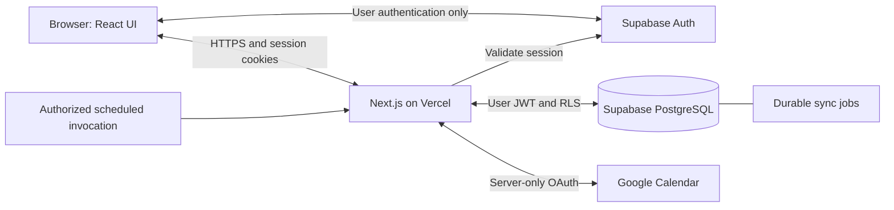

# Ventus — Technical Architecture

**Status:** Proposed architecture; approval gates identified below.

**Reviewed:** October 19, 2026.

## 1. Scope and existing foundation

`PRD.md` governs behavior; `AGENTS.md` governs development; `SECURITY.md` governs release. Recommendations here do not approve unresolved behavior or external services.

The working Next.js foundation has npm checks and GitHub history. Milestone 1 task workflows use in-memory fixtures. Milestone 2 includes email/password auth pages/actions, SSR callbacks, logout, and server-protected Dashboard access. At finalization on October 19, 2026, the project owner reported registration, login, logout, and protected Dashboard access passed manual verification. Password recovery is pending manual verification due to Supabase rate limiting; it is not passed. All 16 automated authentication tests, lint, typecheck, and build pass. Persistence and remaining release checks are pending. Product Phase 2 remains deferred.

## 2. Technology assessment

| Choice | State | Responsibility, fit, and implications |
|---|---|---|
| Next.js 16.4.2, React 19.3.1, TypeScript | Existing | Shared frontend/backend deployment. Follow installed guides, including `proxy.ts` conventions. |
| Tailwind CSS 4 | Existing | Consistent responsive styling without another styling system. |
| shadcn/ui | Proposed | Accessible modal/menu primitives when needed; copied code requires maintenance. Native controls suffice initially. |
| Supabase PostgreSQL and Auth | Auth implemented; application schema/RLS require approval | Official `@supabase/supabase-js` and `@supabase/ssr` are installed. Review the proposed database model, quotas, backups, and costs before migrations. |
| rrule.js (`rrule`) | Proposed; requires approval | Recurrence adapter avoids custom algorithms; validate timezone semantics and maintenance/security. [Guidance](https://github.com/jkbrzt/rrule). |
| Google Calendar API | Product integration approved; technical setup pending | Synchronize linked events. OAuth consent verification, quotas, and refresh failures introduce operational work. |
| Existing checks; Node test runner; Playwright | Checks existing; testing proposed | Built-in runner for pure rules after TypeScript compatibility validation; Playwright for workflows. Consider another unit runner only for simpler configuration. |
| Vercel | Proposed preferred host | Native Next.js previews and deployment. Paid scheduling may be necessary; eligibility and budget remain open. |
| GitHub | Existing | Source/history at `dbellis4-cmd/ventus`; commits, pushes, and deployment integration require explicit instruction. |

Postgres can hold durable synchronization jobs; no separate broker or ORM is needed initially.

## 3. System boundaries

Server Components load authorized data; Client Components handle interaction. Server Actions mutate tasks; Route Handlers serve callbacks and workers. Both call shared domain services and server-only data-access functions.



**PostgreSQL is the canonical task/history store.** Google events are linked representations; incoming edits pass through normal validation and lifecycle rules.

Normal queries carry user JWTs with RLS. Privileged workers enforce ownership separately. Return minimal view models without credentials, following `node_modules/next/dist/docs/01-app/02-guides/data-security.md`.

## 4. Initial database model

Proposed tables; no migrations are authorized here:

| Entity | Minimum purpose and fields |
|---|---|
| `auth.users` / `user_settings` | Managed identity; settings keyed by user ID, IANA timezone, appearance preference. No application password storage. |
| `categories` | Owner, name, default behavior classification, default calendar selection. Snapshot effective behavior when scheduling occurrences. |
| `tasks` | Owner, title, category, location, behavior override, calendar opt-in, version, deletion marker. Represents a definition, including a subtask definition. |
| `task_schedules` | Task, revision, effective interval, local start date/time, timezone, optional RRULE/end condition, generation watermark. Retain superseded schedules. |
| `task_occurrences` | Task/schedule references, immutable recurrence identity, original deadline, current scheduled date/time, status, actual completion time, version, optional parent-occurrence reference. Nonrecurring tasks also have one occurrence. |
| `task_activity` | Task/occurrence, owner, actor/source, action, recorded-at timestamp, actual effective time, relevant before/after values, request ID. Append-only audit history, not a full event-sourcing framework. |
| `calendar_connections` | Owner, Google subject, selected calendar, encrypted credentials/key version, scopes, expiry, sync cursor, connection state. Credentials inaccessible to ordinary database/API users. |
| `calendar_event_links` | Owner, connection, occurrence, Google event ID, last-synced task version, Google ETag, normalized shared-field snapshot. |
| `sync_jobs` | Owner/connection/link, desired version, unique operation key, attempts, next-attempt time, lease expiry, status, sanitized error. Add only with Calendar integration. |

Use UUIDs and owner-matching foreign keys; reject cross-user references and parent cycles. Subtasks link concrete parent occurrences. Subtask recurrence remains undecided.

Unique `(task_id, recurrence_identity)` identifies the original slot across retries/revisions, never its postponed date. Reconcile future slots transactionally under approved series-edit semantics; version increments cannot create duplicates. Uniquely map occurrences and Google events per connection.

Commit mutation, activity, and sync intent atomically using narrow, internally authorized RPCs. Expected-version checks reject stale edits; unique request IDs deduplicate retries. Protect ownership/system fields from direct writes.

Store schedules, snapshots, corrections, and tombstones; calculate counts, overdue status, and rollover display dates. Future point transactions reference occurrences/activity; seasons come later. No reward infrastructure now.

## 5. Authentication and security

**Approved for Milestone 2:** standard Supabase SSR cookie sessions and the official client packages. Browser authentication uses a publishable key and user-session credentials. Registration/login/recovery actions and email callbacks are implemented. Dashboard access, password updates, and the session endpoint verify users with `getUser()`; the proxy refreshes sessions with `getClaims()`. Logout uses local scope and clears navigation state. Mocked tests and anonymous production HTTP checks pass. The owner reports registration, login, logout, and protected Dashboard access manually passed. Password recovery is pending manual verification due to Supabase rate limiting, despite passing mocked regression tests. Preserve those fixes and the session configuration. The existing email-verification policy is respected; confirm it and signup abuse controls before public release. Database requests will carry user JWTs when persistence is introduced.

Browser-readable user access/refresh tokens remain sensitive bearer credentials. Application secret/service-role keys bypass RLS; these and Google tokens must remain server-only.

Use `Secure`, appropriate `SameSite` (normally `Lax`), narrow cookie scope, and supported refresh handling in `proxy.ts`. Browser-managed session cookies are not `HttpOnly`. Authorize every operation, protect against CSRF, validate origins, and prevent cross-user caching. Test expiry/logout/revocation: local JWT validation alone cannot prove session revocation. [SSR guidance](https://supabase.com/docs/guides/auth/server-side/advanced-guide), [Next.js integration](https://supabase.com/docs/guides/auth/server-side/creating-a-client?queryGroups=framework&framework=nextjs).

A server-only `HttpOnly` alternative reduces JavaScript token exposure but requires different auth/refresh handling and server-mediated access. Prefer standard SSR for maintainability unless stricter isolation is required.

`AGENTS.md` now permits browser-side Supabase user-session tokens through this approved flow, while keeping privileged application credentials and Google OAuth tokens server-only. RLS, XSS, CSRF, and session protections remain required.

Enable ownership RLS from the first migration. Test anonymous/two-user database access. Deny user access to provider credentials and protected writes; review functions/views for bypass. [RLS guidance](https://supabase.com/docs/guides/database/postgres/row-level-security).

Validate server inputs/references, parameterize queries, escape content, and apply `SECURITY.md`. Rate limiting and bot protection precede public signup.

## 6. Lifecycle, recurrence, and time

Create definition, schedule, occurrence, and activity atomically. Edits preserve original scheduling; completion stores actual and recorded times. Corrections append history. Subtask completion never automatically completes the parent.

Expand requested windows plus bounded lookahead. Resume elapsed-interval catch-up from a watermark so missed occurrences are not lost. Upsert immutable slots and retain historical occurrences; never expand infinite rules without bounds.

Approved behavior maps to these projections:

- Fixed commitments stay on their scheduled historical dates.
- Consequential unfinished deadlines appear overdue while retaining original deadlines.
- Flexible unfinished occurrences project onto the eligible day without daily duplication; history uses stored schedules/activity. Collision with the next recurrence requires approval.
- Postponement records schedule changes; cancellation is distinct. Propose soft deletion preserving references, subject to retention approval.

Use date-only anytime tasks, IANA schedule zones, and UTC instants. Recurrence follows wall-clock time rather than 24-hour addition. Propose a stable account timezone; travel, DST gaps/folds, month-end/leap-day behavior, and overdue cutoffs require approval. Test rrule conversions. No precise midnight execution is needed.

## 7. Google Calendar synchronization

Use per-user authorization-code consent, validated state, exact redirects, and supported PKCE. Background sync needs offline access. Encrypt tokens using established authenticated encryption/versioned server keys; serialize refresh and exclude secrets from user-readable data/logs. [Google OAuth](https://developers.google.com/identity/protocols/oauth2/web-server).

Propose one owned calendar initially and the narrowest event-write scope compatible with it (`calendar.events.owned` candidate); broader/shared-calendar support requires review. [Scope reference](https://developers.google.com/workspace/calendar/api/auth).

Commit outbound intent first. Bounded workers use leases, retry classification, and capped backoff/jitter. Google-compatible deterministic IDs deduplicate creation; conditional ETag writes prevent blind overwrites. [Event creation](https://developers.google.com/workspace/calendar/api/v3/reference/events/insert).

Poll per-calendar incremental cursors in resumable pages; advance cursors after durable processing. HTTP 410 triggers remote-snapshot rebuilding, preserving Ventus history. Only known links affect tasks. [Incremental synchronization](https://developers.google.com/workspace/calendar/api/guides/sync).

Compare shared-field snapshots and versions to suppress echoes; record mutation source. When both sides changed, propose pausing the link for resolution. Conflict UI and external-deletion behavior require approval.

Propose one event per materialized occurrence. Native recurring masters reduce volume but complicate exceptions. Approve representation/export horizon; preserve links on rescheduling. Surface Google series conversions and unsupported edits for resolution. [Recurring-event semantics](https://developers.google.com/workspace/calendar/api/guides/recurringevents).

Propose title/location/schedule mapping, with anytime tasks as all-day dates and exclusive ends. Timed-event duration is absent from the PRD. Approve duration, cancellation/deletion, sync-unchecking, and recurrence-edit mappings. Event edits never automatically complete tasks.

Disconnect immediately blocks jobs, revokes grants, and removes tokens after safe failure handling. Propose preserving Google events; approve reconnect reconciliation.

## 8. Application structure

Create paths only as needed:

```text
app/                         pages, layouts, colocated Server Actions
  (auth)/                    signup/login/recovery pages
  (app)/dashboard/, settings/ protected application pages
  auth/callback/             Supabase callback
  api/google/                OAuth callbacks and sync endpoints
  api/jobs/                  authenticated bounded worker invocation
components/                  shared UI and task/dashboard components
lib/tasks/                   pure lifecycle, recurrence, time rules
lib/server/                  auth, data access, task services, Google adapters
lib/validation/              boundary schemas/validation functions
tests/                       unit, database integration, Playwright workflows
supabase/migrations/          versioned schema/RLS, when approved
proxy.ts                     session refresh if required
```

Keep server modules explicitly server-only. No generic repository framework or duplicated REST layer for internal component reads.

## 9. Testing, hosting, and operations

Develop with `npm run dev`; run lint, typecheck, build, and relevant tests. Unit-test lifecycle, recurrence, date boundaries, and idempotency. Integration-test transactions/RLS with anonymous and two-user credentials. Browser-test registration, dashboard editing, logout, and Calendar failure recovery; use dedicated test calendars.

Commit/push only when instructed. Once deployment is authorized, use reviewed GitHub changes for previews with isolated nonproduction data, OAuth clients/redirects, and secrets. Production requires the `SECURITY.md` gate, owner approval, and rollback readiness. Separate public configuration from server credentials; never prefix secrets with `NEXT_PUBLIC_`.

Vercel Hobby permits personal noncommercial use and has usage limits. Each Hobby cron runs at most daily with imprecise timing; frequent reliable background sync needs approved paid scheduling or another scheduler. Functions are bounded invocations, not permanent workers. Start with action-triggered delivery, sync on dashboard entry/manual refresh, and a daily recovery sweep; this prototype does **not** guarantee prompt sync while users are absent. Agree freshness before release. [Hobby eligibility](https://vercel.com/docs/plans/hobby), [Cron limits](https://vercel.com/docs/cron-jobs/usage-and-pricing).

Polling avoids initial webhook lifecycle overhead. Google push notifications can later wake incremental sync, but require expiring-channel renewal and recovery polling. [Push guidance](https://developers.google.com/workspace/calendar/api/guides/push). A conventional Node host with a worker is an alternative only if continuous processing justifies server operations.

Record redacted failures, retry backlog, stale connections, and alerts. Select backup retention/recovery targets and rehearse restores before real-data release; do not assume free plans include adequate recovery. [Supabase backups](https://supabase.com/docs/guides/platform/backups).

`SECURITY.md` records five high-severity development-chain findings and zero production audit findings on October 19. Review compatible remediation before release; do not apply npm's suggested lint-package downgrade blindly. No dependency fixes or new audits were performed for this architecture task.

## 10. Incremental roadmap

| Milestone | Deliverable and dependencies | Verification |
|---|---|---|
| 1. Interactive dashboard | Existing React/Tailwind; local fixtures, Sunday–Saturday navigation, sections, completion toggles, shared create/edit modal. Explicitly temporary in-memory state. | Date/week navigation, sorting, modal editing, keyboard/touch behavior, responsive layout, existing checks. |
| 2. Authentication foundation | Registration/login/logout, protected Dashboard, SSR clients/callbacks, and recovery implementation finalized. Settings remain a placeholder; database/RLS harness awaits persistence. | Owner-reported manual registration/login/logout/protected Dashboard passes; 16 automated tests and npm checks pass. Password recovery pending manual verification due to Supabase rate limiting. Remaining session/abuse checks still gate release. |
| 3. Persistent task lifecycle | Approved schema/categories; CRUD, dated subtasks, completion corrections, postponement/cancellation/history. | Transaction rollback, ownership tampering, stale edits, no automatic parent completion. |
| 4. Recurrence and missed tasks | Approved rrule/time/rollover/series rules. | DST/month boundaries, bounded catch-up, duplicate retries, historical preservation. |
| 5. Calendar outbound | Approved OAuth/scopes/mapping; encrypted connections, links, durable jobs. | Retry without duplicate events, refresh/revocation, unrelated-event safety. |
| 6. Calendar inbound | Approved conflicts/deletions/recurrence mapping/freshness. | Two-way changes, echo suppression, 410 recovery, conflicts, disconnect and failures. |
| 7. Release hardening | Approved host/budget; production settings, monitoring, recovery and full acceptance tests. | All applicable security controls verified; PRD workflows pass; explicit deployment approval. |
| Later: product Phase 2 | Separate approval and scoring decisions; reuse occurrence/activity history. | Reward/season invariants defined before implementation. |

## 11. Decision Register

| Decision | Recommendation | Status | Rationale |
|---|---|---|---|
| Application stack | Retain installed Next.js/React/TypeScript/Tailwind | Existing | Working foundation. |
| Product scope | Implement PRD Phase 1; defer rewards | Approved | Existing product direction. |
| System organization | Modular monolith; PostgreSQL canonical tasks | Proposed | One codebase and durable integrity boundary. |
| Persistence/auth | Supabase with user-scoped RLS | Auth approved/implemented; schema and migrations require approval | Database modeling and isolation tests must precede persistent user data. |
| Sessions | Standard Supabase SSR; browser-readable user-session tokens | Approved for Milestone 2 | Registration/login/logout/protected Dashboard manually passed per owner; password recovery pending manual verification due to Supabase rate limiting. |
| History/recurrence | Occurrences, schedule revisions, append-only activity; rrule | Proposed | Preserve corrections and future scoring inputs. |
| Integration execution | Postgres jobs and bounded polling workers | Proposed | Durable retries without a separate broker. |
| Calendar semantics | Per-occurrence export; pause conflicts | Requires Approval | Observable behavior and interoperability tradeoffs. |
| Hosting | Vercel; approve plan against sync requirements | Requires Approval | Hobby cannot promise frequent background polling. |

## 12. Open Questions and Technical Risks

| Priority / decision | Risk or required approval | Resolve by |
|---|---|---|
| High: session verification | Core registration/login/logout/protected Dashboard manually passed per owner. Recovery is pending manual verification due to Supabase rate limiting. Verify expiry/refresh, revocation, Back/multiple-tab behavior, and deployed cache isolation before public release; privileged/Google tokens remain server-only. | Milestone 2 follow-up / release |
| High: lifecycle semantics | Approve categories, overdue cutoffs, timezone/travel/DST rules, recurrence editing, subtask recurrence, and unfinished recurrence collision behavior. | Milestones 3–4 |
| High: Calendar mapping | Approve target calendar/scope, duration, all-day mapping, export horizon, cancellation/deletion/uncheck behavior, external deletion, conflicts, and reconnect policy. OAuth verification may delay release. | Milestones 5–6 |
| High: sync reliability/cost | Approve freshness target and scheduling budget; test quotas, retries, pagination, leases, and refresh concurrency. | Milestone 6, before release |
| High: retention/security | Approve deletion/backup retention and recovery targets; resolve audit findings and verify RLS. | Database design through release |
| Deferred: scoring | Late flexible-task XP wording, correction/undo effects, locked-season edits, zero-point denominators, and percentage boundaries remain unresolved. | Before product Phase 2 |

## 13. Milestone 3 entry decisions

The following decisions require approval before implementing migrations. This is
preparation only; no application tables, policies, or persistent task code are
authorized by finalizing Milestone 2.

| Decide first | Required outcome |
|---|---|
| Initial schema and settings bootstrap | Approve the first subset of the proposed `user_settings`, `categories`, `tasks`, `task_schedules`, `task_occurrences`, and `task_activity` model; decide how a user's settings/categories are created. Defer Calendar/job/reward tables. |
| Ownership, grants, and RLS | Define owner references to Supabase Auth users, immutable ownership/protected fields, owner-matching parent/subtask references, allowed operations, and anonymous denial. Approve direct Data API tests with anonymous and two-user identities before exposing records. |
| Categories and behavior | Finalize fixed defaults versus user-managed categories, fixed/flexible/deadline behavior, and allowed overrides. PRD examples are not an approved fixed category list. |
| Date/time and lifecycle storage | Decide account timezone, date-only anytime tasks, start/end-time constraints, original versus changed schedules, parent-occurrence/subtask relationships, and actual versus recorded completion timestamps. Preserve recurrence/history integrity without implementing Milestone 4 rules early. |
| History, deletion, and recovery | Approve cancellation/deletion/account-deletion retention and cascading behavior, protected activity history, backup/restore targets, and retention consistent with private accounts. |
| Mutation and migration boundaries | Approve atomic task/history writes, stale-edit/version checks and retry identifiers, constraints and validation, and a versioned migration/testing workflow isolated from live user data. |

Keep the pending manual password-recovery verification visible while planning
Milestone 3. It must not be represented as passed by the mocked tests or by the
Milestone 2 commit.
