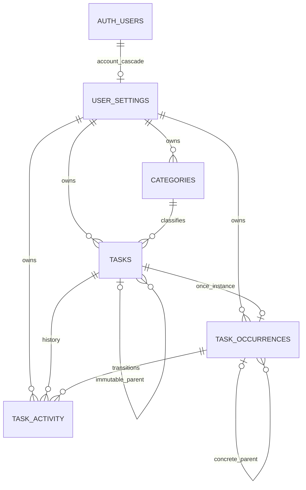

# Milestone 3 — database schema and security

**Approved five-table foundation; applied to hosted development.** Both migrations
passed 132 local assertions, then succeeded on hosted project
`dxplprepnfuvfpqmmslf`, branch `main`. Hosted structural verification passed;
hosted user-level behavior and application persistence remain untested/unfinished.
See [local evidence](tests/RESULTS.md) and [hosted evidence](tests/HOSTED_RESULTS.md).
These replaced never-applied earlier drafts. Do not reapply/reset or edit the
applied migration files; their draft headers are preserved to retain tested hashes.

## Scope and files

- `migrations/20261019000100_task_schema_and_rls.sql`: five tables, constraints,
  triggers, restricted writer role, ownership RLS and grants.
- `migrations/20261019000200_workspace_initialization.sql`: private helpers and
  ten public RPCs, including atomic nonrecurring task lifecycle operations.
- [OPERATIONS.md](OPERATIONS.md): inputs, transaction/concurrency contracts,
  initialization and proposed permanent account-deletion workflow.
- [tests/PLAN.md](tests/PLAN.md): local subset passed; additional cases remain pending.
- `check_design.py`: dependency-free lexical/security-inventory checks only.

The owner's later approvals replaced the earlier six-table/schedule-revision
proposal and settled category/account-deletion principles. ARCHITECTURE.md now
reflects the applied design.
PRD Phase 1 behavior and SECURITY.md verification requirements remain binding.
No app features, provider changes, jobs, OAuth, uploads or reward tables are added.

## Tables and relationships

| Table | Purpose / protected data |
|---|---|
| `user_settings` | One row per Auth user, selected IANA timezone, appearance, immutable initialization marker, server timestamps/version. |
| `categories` | Owned name, behavior, calendar default, immutable optional seed key, archive marker, version. Users may create/rename categories and archive/unarchive them. |
| `tasks` | Definition, category, stable optional parent, title/location, behavior/calendar overrides, soft deletion/version. The top node of a creation command carries an immutable owner-scoped retry key and SHA-256 input fingerprint. |
| `task_occurrences` | One `once` occurrence per nonrecurring definition; concrete parent occurrence; immutable original and editable current local dates/times/zones/UTC instants; definition/category snapshot; completion, recording, cancellation, soft deletion and version. |
| `task_activity` | Append-only relevant before/after task/occurrence states, action, actual/effective and server recording times. Unique occurrence/version prevents duplicate history for a transition. No request/response receipts. |

A definition and its occurrence are created together by an RPC. The diagram uses
zero-or-one because uniqueness prevents multiple nonrecurring occurrences, while
existence is guaranteed by the transactional creation function, not an FK in the
reverse direction. The key `once` never changes when dates change. Milestone 4
must approve recurrence identities and generation before relaxing that constraint.

Composite foreign keys include ownership (and task ID for activity) to reject
cross-user category/parent/occurrence references independently of UI validation.
Parents must already exist, be owned and active; immutable links prevent cycles
and reassignment. The depth bound is ten edges. Subtasks have independent dates
and completion; completing children never completes their parent.

Original schedule fields cannot change. Creation and each mutation record relevant
business states; snapshots preserve historical category names/behavior after
renaming or archiving. Closed occurrence snapshots cannot be rewritten. Editing
an open task explicitly refreshes its display snapshot while retaining the prior
snapshot in history. Postponement/completion/deletion do not refresh it implicitly.
Reopening clears the current completion projection, not earlier completion events.
No points/XP values or scoring policies are introduced or inferred retroactively.

## Security and transaction boundary

- RLS is enabled and forced on all five tables. Authenticated readers see only
  their UID's rows, including owned history/tombstones. Normal day queries exclude
  tombstones. Anon has no table access.
- API roles have no direct DML, TRUNCATE or trigger privileges, including own rows.
  Public mutation functions have typed inputs or exact JSON allowlists, explicit
  UID/ownership checks, qualified static SQL, empty search paths, restricted
  EXECUTE grants and `row_security=on`.
- All public RPCs are owned by one NOLOGIN/NOINHERIT/NOBYPASSRLS role that does not
  own the tables. It has owned INSERT/UPDATE access, history INSERT only, no DELETE
  and no API-role membership. No elevated key is used for normal requests.
- Writer UID resolution uses a private SECURITY INVOKER SQL helper that delegates
  to `auth.uid()` with the SQL-standard body parsed at migration definition time.
  It needs no runtime Auth-schema lookup or privileged definer; standard stored
  ownership RLS continues to use `auth.uid()`. This fixes the observed local managed
  schema-ACL reset without broadening Auth permissions.
- Server timestamps, versions, identity, seed keys, original slots and history
  are not caller-writable. Next.js integration must still verify the current user
  and origin/CSRF boundary; it is not implemented here.
- Each task transaction locks the affected immutable hierarchy root first, then
  validates current target versions. No task trigger/RPC locks `user_settings`.
  Independent roots can progress concurrently. Child insertion, mixed edits and
  subtree deletion share the same root lock, preventing phantom-child races.
- Every actual task mutation increments the target definition/occurrence versions
  and writes history atomically. A child command also advances the root task's
  version once as a tree-change marker; this metadata-only bump needs no duplicate
  business event. Batch edits/delete require the observed root version as well.
- Creation uniqueness plus a canonical-input fingerprint prevents duplicate trees
  or reuse of a key for different input. Other retries retain their original
  expected versions: conflicts cause refetch, never automatic fresh-version retry.
  There is no guarantee of replaying a previously returned response.

Indexes cover owner/day, open original deadlines, parent/category references and
history pagination. Uniqueness covers active category names, seed keys, creation
keys, occurrence identities and occurrence-version history events.

## Time zones and defaults

Every schedule supplies a selected IANA zone (or UTC), independent of the database
session zone. Both original and current slots retain their own zone. Account
preference changes affect future defaults only; no travel detection or automatic
migration of existing schedules occurs.

Anytime tasks have a local date and zone with null start/end times and instants.
Timed tasks supply local date/time plus a timestamp containing an explicit offset;
UTC instants must round-trip to that local date/time/zone. DST gaps are rejected.
For folds, the caller must explicitly choose the matching instant/offset; the
application must present that choice rather than guess. Optional ends require an
end date, local time and matching instant after the start; overnight representation
is supported. No default duration, anytime overdue cutoff or rollover is invented.

Lazy `initialize_workspace(timezone)` creates settings and these exact approved
names once: **Classes, Meetings, Assignments, Professional Events, Social Events,
Personal Tasks, Miscellaneous**. Seed keys survive renames/archive; initialization
never resets existing preferences or recreates defaults. It is the sole initializer
that explicitly locks the owner's settings row. No Auth signup trigger can break
registration. Proposed initial behavior mapping follows the earlier draft: fixed
for Classes/Meetings/Professional Events/Social Events, deadline for Assignments,
flexible for Personal Tasks/Miscellaneous. Category behavior remains editable.
Calendar defaults follow PRD; no actual Calendar connection is created.

## Permanent account deletion

Individual tasks are soft-deleted; account erasure permanently removes all five
tables' owned personal data. `auth.users -> user_settings -> owned tables` uses
ON DELETE CASCADE. Cross-table references use deferred NO ACTION checks so removal
of the entire account is order-independent while dangling references remain illegal
at commit. No application-table DELETE privilege/policy is opened.

Activity UPDATE always fails. Activity DELETE fails while its Auth owner exists.
A single private **postgres-owned SECURITY DEFINER trigger**, with an empty search
path and no API execute grants, checks only whether `auth.users` still contains
that owner. It permits the Auth-user cascade after that row is gone. This narrow
privileged exception is required because the writer cannot read managed Auth data;
it does not provide a deletion RPC or bypass RLS on ordinary application writes.
Its behavior under the actual Supabase Auth-admin role/cascade is a mandatory test.

A future server-only, explicitly confirmed and recently reauthenticated account
workflow will derive the UID from the verified session, revoke sessions, and call
Supabase Admin permanent user deletion. No user-supplied target UID or browser
admin credential is permitted. See OPERATIONS.md for authorization, retry/failure,
backup/log retention and future provider/storage cleanup. No deletion UI/endpoint
or live deletion is implemented by this proposal.

## Remaining review and verification gates

- Approve/refine initial category behavior mapping and operational bounds (64 KiB,
  100 changed nodes, ten hierarchy edges). Approved names/privacy/timezone principles
  are settled; these implementation choices remain reviewable.
- Decide anytime overdue cutoffs, overnight UI/duration, cancellation reversal and
  recurring series/subtask/travel semantics when their features are implemented.
  Canceled tasks currently cannot reopen; closed definition edits require reopen.
- Define reauthentication freshness, MFA policy, account-erasure recovery/retry,
  backup expiration and restoration suppression before exposing account deletion.
- Retain disposable-only behavioral tests for role creation,
  function ownership, PL/pgSQL, grants, RLS, constraints, atomicity and concurrency.
  The executable local subset now passes; exhaustive/performance/recovery and future
  endpoint checks remain pending as detailed in tests/RESULTS.md. No live data or
  production users may be used.
- Preserve password recovery as **pending manual verification due to Supabase rate
  limiting**. Database work does not resolve it or grant public-release approval.

References: [Supabase RLS](https://supabase.com/docs/guides/database/postgres/row-level-security),
[function security](https://supabase.com/docs/guides/database/functions),
[Auth-user deletion](https://supabase.com/docs/guides/auth/managing-user-data#deleting-users),
[PostgreSQL constraints](https://www.postgresql.org/docs/current/ddl-constraints.html),
[row locking](https://www.postgresql.org/docs/current/explicit-locking.html),
[time zones](https://www.postgresql.org/docs/current/datatype-datetime.html).
